# 👋 Hey, I'm Raphael!

  

  **RPA Developer | Software Developer | Automation Enthusiast**

  🇫🇷 Northern France

  
  
  

---

## 👨🏻‍💻 About Me

I'm a French software developer passionate about **software engineering, robotic process automation (RPA), and web development**.

I enjoy designing applications, automating business processes, and building solutions that make everyday tasks easier and more efficient.

My experience combines professional RPA development with web application development and software engineering.

- 🤖 RPA development and business process automation.
- 💻 Backend development and software architecture.
- 🌐 Web application development with PHP and Laravel.
- ⚙️ CI/CD, DevOps and software quality.
- 🧠 Exploring AI and intelligent automation.
- 🚀 Always learning and experimenting with new technologies.

---

## 🛠️ Tech Stack & Tools

**🤖 RPA & Automation**

  
  
  
  
  

**💻 Development**

  
  
  
  
  
  
  
  

**⚙️ DevOps & Tools**

  
  
  
  
  
  

---

## 🚀 Featured Projects

### 🐶 WoofLand

A Laravel-based web application designed to help a canine education association manage its activities.

- Member and dog management.
- Course registration and activity management.
- Authentication and role-based permissions.
- News and communication features.
- Automated testing and CI/CD integration.

**Stack:** PHP · Laravel · MySQL · Tailwind CSS · GitHub Actions · SonarCloud

### 🔧 Other Projects

- [Automate Install Armbian X96 Mini](https://github.com/RaphDzi/automateInstallArmbianx96Mini) – Automation scripts for installing Armbian on an X96 Mini Android TV box.
- [Flutter Restaurant App](https://github.com/RaphDzi/flutter_restaurant_app) – A restaurant ordering application built with Flutter.

---

## 📊 GitHub Statistics

  <picture>
    <source media="(prefers-color-scheme: dark)" srcset="./assets/overview.dark.svg">
    
  </picture>
  <picture>
    <source media="(prefers-color-scheme: dark)" srcset="./assets/languages.dark.svg">
    
  </picture>
  <picture>
    <source media="(prefers-color-scheme: dark)" srcset="./assets/contributions.dark.svg">
    
  </picture>

---

## 🐍 Contribution Graph

  <picture>
    <source media="(prefers-color-scheme: dark)" srcset="https://raw.githubusercontent.com/RaphDzi/RaphDzi/output/github-snake-dark.svg"/>
    <source media="(prefers-color-scheme: light)" srcset="https://raw.githubusercontent.com/RaphDzi/RaphDzi/output/github-snake.svg"/>
    
  </picture>

---

## 🌱 Currently Exploring

- Advanced software architecture and design patterns.
- Intelligent automation and AI-powered workflows.
- Advanced .NET development.
- DevOps and CI/CD pipelines.
- Software quality, testing and maintainability.

---

## 🤝 Let's Connect!

I'm always interested in discovering new technologies, discussing software engineering, and collaborating on interesting projects.

  
  

  **Thanks for visiting my profile! Have a great day! 🚀**

